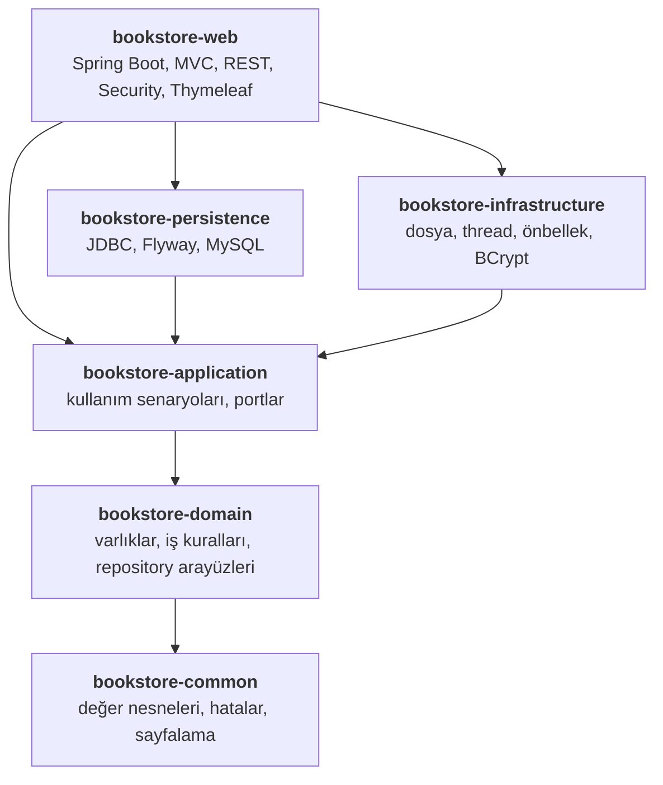
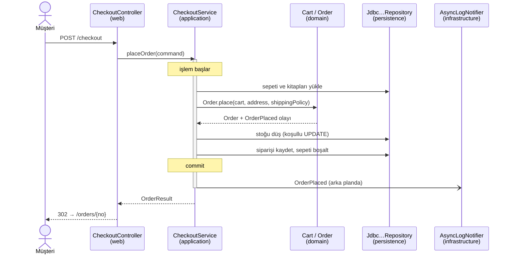
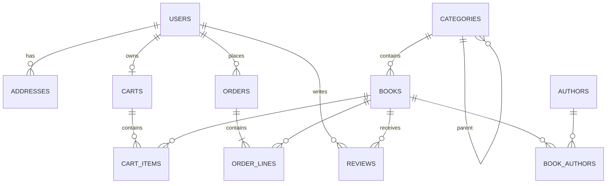

# Book Store — Mimari

Bu doküman sistemin **nasıl** kurulduğunu tanımlar. **Ne** yaptığı [SPEC.md](SPEC.md) içinde, kararların gerekçeleri [DECISIONS.md](DECISIONS.md) içindedir.

## 1. Genel bakış

Book Store, tek bir süreç olarak çalışan (**monolit**), Maven ile **çok modüllü** ve **katmanlı** bir web uygulamasıdır.

Temel fikir: iş kuralları **saf Java** ile yazılır ve hiçbir framework'e bağlı değildir. Veritabanı, dosya sistemi ve web gibi dış dünya ayrıntıları, iş kurallarının tanımladığı arayüzleri (*port*) uygulayan ayrı modüllerdedir (*adapter*). Spring Boot yalnızca en dış modülde yer alır ve parçaları birbirine bağlar.

Bu yapı iki işe yarar:

- Müfredatın temel konuları (OOP, koleksiyonlar, generics, JDBC, thread, I/O) framework'ün arkasına saklanmadan, elle yazılmış kodda görünür.
- Modern framework kullanımı (Spring MVC, Security, Thymeleaf) aynı projede, doğru yerde durur.

| Konu | Seçim |
|---|---|
| Dil | Java 21 (LTS) |
| Derleme | Maven 3.9, Maven Wrapper (`mvnw`) |
| Web framework | Spring Boot 4.1 (Spring MVC, Spring Security) |
| Arayüz | Thymeleaf (sunucu tarafı HTML) + JSON REST API |
| Veritabanı | MySQL 8.4; testlerde H2 (MySQL uyumluluk modu) |
| Şema yönetimi | Flyway |
| Veri erişimi | Elle yazılmış JDBC (DAO kalıbı) |
| Test | JUnit 5, AssertJ, Mockito |
| Kayıt | SLF4J + Logback |

## 2. Modüller



| Modül | Sorumluluk | Bağımlı olabildiği |
|---|---|---|
| `bookstore-common` | Her katmanın kullandığı küçük, genel yapı taşları: `Money`, hata hiyerarşisi, `Page<T>`, doğrulama yardımcıları. | Yalnızca JDK |
| `bookstore-domain` | İş modeli ve iş kuralları: `Book`, `Cart`, `Order` … Repository **arayüzleri** burada tanımlanır. | `common` |
| `bookstore-application` | Kullanım senaryoları (*use case*): "sepete ekle", "sipariş ver". Domain nesnelerini orkestre eder, işlem (*transaction*) sınırını belirler. Dış dünyaya ihtiyaç duyduğu şeyleri **port** arayüzü olarak tanımlar. | `domain` |
| `bookstore-persistence` | Repository arayüzlerinin JDBC ile uygulanması, SQL, şema migration'ları. | `application` |
| `bookstore-infrastructure` | Veritabanı dışındaki port uygulamaları: dosya depolama, arka plan bildirimleri, önbellek, parola özetleme, ödeme simülasyonu, demo verisi yükleme. | `application` |
| `bookstore-web` | HTTP katmanı: controller'lar, şablonlar, REST API, güvenlik, yapılandırma ve tüm parçaların birbirine bağlanması. Çalıştırılabilir uygulama burasıdır. | hepsi |

### Bağımlılık kuralı

> Bağımlılıklar her zaman **içe doğru** akar: `web → application → domain → common`.

- `common`, `domain` ve `application` modüllerinde **Spring, Servlet, JDBC veya herhangi bir framework sınıfı kullanılmaz.** Yalnızca JDK ve SLF4J API'si.
- `domain`, veritabanının ya da web'in varlığından habersizdir.
- `persistence` ve `infrastructure` birbirini görmez.
- Kural Maven tarafından zorlanır: bir modülün `pom.xml` dosyasında olmayan bağımlılık derlenmez.

## 3. Paket yapısı

Kök paket `com.bookstore`. Her modülün içi **özelliğe göre** paketlenir (katmana göre değil): `catalog`, `cart`, `order`, `customer`, `review`.

```
bookstore-common          com.bookstore.common
  ├─ money                Money, Currency işlemleri
  ├─ error                BookstoreException ve alt türleri
  ├─ paging               Page<T>, PageRequest, SortOrder
  ├─ validation           Guard (ön koşul denetimleri)
  └─ text                 Türkçe duyarlı metin normalleştirme

bookstore-domain          com.bookstore.domain
  ├─ (kök)                Entity — kimlik, sürüm ve olay toplama için ortak taban sınıf
  ├─ catalog              Book, Author, Category, Isbn, Stock, Language, RatingSummary,
  │                       BookSearchCriteria, BookSort, InsufficientStockException, …Repository
  ├─ cart                 Cart, CartItem, CartRepository
  ├─ order                Order, OrderLine, OrderStatus, OrderNumber, PaymentMethod,
  │                       ShippingPolicy, FreeShippingThreshold, OrderRepository
  ├─ customer             Customer, SavedAddress, Address, Email, PersonName, Role,
  │                       PasswordPolicy, CustomerRepository
  ├─ review               Review, Rating, RatingDistribution, ReviewRepository
  └─ event                DomainEvent (sealed), OrderPlaced, OrderStatusChanged

bookstore-application     com.bookstore.application
  ├─ catalog              CatalogService, BookSearchQuery, BookSummary, BookDetails, CategoryNode
  ├─ cart                 CartService, CartRef (sealed), CartView, CartChangedException
  ├─ order                CheckoutService, OrderService, PlaceOrderCommand, OrderSummary,
  │                       OrderDetails, PaymentDeclinedException
  ├─ account              AccountService, RegistrationCommand, CustomerView, LoginAccount
  ├─ review               ReviewService, ReviewCommand, ReviewView
  ├─ admin                OrderAdminService; Faz 7'de CatalogAdminService, UserAdminService,
  │                       ReviewAdminService
  └─ port                 TransactionRunner, PasswordHasher, Notifier, PaymentGateway,
                          OrderNumberSequence; Faz 7'de FileStorage

bookstore-persistence     com.bookstore.persistence
  ├─ (kök)                DatabaseMigrator (Flyway)
  ├─ jdbc                 JdbcTransactionRunner, JdbcExecutor, RowMapper<T>, RecordRowMapper<R>,
  │                       Columns, DataAccessException
  ├─ catalog              JdbcBookRepository, BookSearchSql, JdbcAuthorRepository,
  │                       JdbcCategoryRepository
  ├─ cart | customer | review                        Jdbc…Repository
  ├─ order                JdbcOrderRepository, JdbcOrderNumberSequence
  └─ resources/db/migration                          V1__initial_schema.sql

bookstore-infrastructure  com.bookstore.infrastructure
  ├─ storage              LocalFileStorage (NIO.2)
  ├─ notification         AsyncLogNotifier (ExecutorService)
  ├─ cache                ConcurrentCache<K,V>
  ├─ security             BCryptPasswordHasher
  ├─ payment              SimulatedPaymentGateway
  └─ seed                 DemoDataLoader (CSV)

bookstore-web             com.bookstore.web
  ├─ config               Bean tanımları, güvenlik, i18n
  ├─ mvc                  Thymeleaf controller'ları ve form nesneleri
  ├─ api.v1               REST controller'ları, DTO'lar, hata eşleme
  ├─ security             Spring Security ↔ Customer uyarlaması
  └─ resources            templates/, static/, messages_*.properties, application.yml
```

## 4. Katmanların ayrıntısı

### 4.1 Domain

- **Varlıklar** (`Book`, `Order` …) kimlikleri olan, durumu değişebilen sınıflardır ve `Entity` taban sınıfından türer. Kendi kurallarını kendileri korur: geçersiz bir `Order` nesnesi oluşturulamaz. Yeni bir varlığın kimliği yoktur; repository kaydettikten sonra `markPersisted(id, version)` ile atar. Depodan yüklenen varlıklar `restore(…)` fabrika metotlarıyla, doğrulamadan geçerek oluşturulur.
- **Değer nesneleri** (`Money`, `Isbn`, `Email`, `Rating`, `Stock`) değişmezdir ve `record` olarak yazılır. Doğrulama kurucu içinde yapılır.
- **Sipariş durumu** bir durum makinesidir. İzin verilen geçişler `OrderStatus` içinde tanımlıdır; geçersiz geçiş istisna fırlatır.
- **Kargo ücreti** `ShippingPolicy` arayüzü ile hesaplanır (Strategy kalıbı).
- **Repository arayüzleri** domain dilini konuşur (`findByIsbn`, `save`), SQL ya da tablo adı içermez.
- **Domain olayları** (`OrderPlaced`, `OrderStatusChanged`) bir şey olduğunda varlığın içinde `raise(…)` ile kaydedilir; application katmanı kayıttan sonra `pullEvents()` ile toplayıp yayınlar. Kimin dinlediğini domain bilmez (Observer kalıbı).
- **Arama ölçütü** (`BookSearchCriteria`) ve **sıralama** (`BookSort`) domain'dedir, çünkü `BookRepository` arayüzü onları kullanır. Ölçüt, bellek içi repository'ler için `asPredicate()`, sıralama `comparator()` verir; JDBC repository aynı ölçütü SQL'e çevirir.
- **Puan özeti** (`RatingSummary`: yorum sayısı ve toplam puan) kitabın üzerinde tutulur; listeler ve "puana göre sırala" yorum tablosunu her istekte saymaz.

### 4.2 Application

Her kullanım senaryosu bir servis metodudur. Tipik bir metot:

1. Girdiyi bir **komut** nesnesi (`record`) olarak alır.
2. Bir işlem başlatır (`TransactionRunner`).
3. Repository'lerden domain nesnelerini yükler.
4. İş kuralını **domain nesnesine** yaptırır.
5. Sonucu kaydeder, olayları yayınlar, bir **sonuç** nesnesi döner.

Application servisleri HTTP, HTML, JSON ya da SQL bilmez. Bu yüzden veritabanı olmadan, sahte (*in-memory*) repository'lerle test edilebilir.

Ek kurallar:

- **Okuma modelleri:** Servisler web katmanına domain varlıklarını değil, değiştirilemez `record` kopyalarını döner (`BookSummary`, `CartView`, `OrderDetails` …). Böylece web katmanı bir varlığı yanlışlıkla değiştiremez.
- **Önce doğrulama:** Girdi, işlem başlamadan önce değer nesnelerine çevrilerek doğrulanır (`Email.of`, `Rating.of`, `PasswordPolicy.check`). Geçersiz bir istek hiçbir işlem açmaz.
- **Olaylar commit'ten sonra:** Domain olayları işlem içinde toplanır, `Notifier`'a işlem başarıyla bittikten sonra verilir. Geri alınan bir işlem için müşteriye bildirim gitmez.
- **Sepet referansı:** Sepet işlemleri `CartRef` alır: `Guest` (HTTP oturumundaki sepet, yerinde değiştirilir) ya da `Customer` (veritabanındaki sepet, yüklenip kaydedilir). Servis ikisini bir `switch` ile ayırır.

### 4.3 Persistence

- Her repository arayüzü için bir `Jdbc…Repository` sınıfı vardır (DAO kalıbı).
- Yalnızca `PreparedStatement` ve parametreli sorgu kullanılır. `JdbcExecutor` bağlantı alma, bağlama, çalıştırma ve kapatma adımlarını tek yerde yapar (Template Method); repository'ler yalnızca SQL'i ve bir `RowMapper` verir.
- `JdbcTransactionRunner`, işlemin bağlantısını bir `ThreadLocal` içinde taşır. Aynı thread'deki bütün repository çağrıları aynı `Connection`'ı kullanır; hata olursa `rollback`, başarıda `commit` yapılır. İç içe işlemler dıştakine katılır. İşlem dışındaki okumalar kısa ömürlü, otomatik commit'li bir bağlantı alır.
- Bağlantı havuzu (HikariCP) `DataSource` olarak dışarıdan verilir (Faz 5'te web modülü kurar); modül Spring'e bağımlı değildir.
- **Yükleme:** Bir sayfa kitap, kaç kitap olursa olsun üç sorguyla yüklenir: kitap satırları, tüm yazarları ve kategori ağacı. Kitap başına ayrı yazar sorgusu çalıştırılmaz (N+1 sorgu sorunu).
- **Arama:** `BookSearchSql`, domain'deki `BookSearchCriteria` ile aynı kuralları SQL'e çevirir. Türkçe harf duyarsızlığı için `books.title_key` ve `authors.name_key` sütunları `TextNormalizer` ile üretilmiş anahtarları tutar; aranan metin de aynı şekilde normalleştirilir. Bir test, her sıralama seçeneğinde SQL'in ve bellek içi kuralların aynı sonucu verdiğini doğrular.
- **Eşzamanlılık:** Değişen tablolarda `version` sütunu vardır. `UPDATE … WHERE id = ? AND version = ?` hiçbir satırı değiştirmezse kayıt arada başkası tarafından değiştirilmiş demektir ve `ConflictException` (`concurrent-modification`) fırlar. Aynı son kopyayı aynı anda alan iki siparişten biri bu yüzden geri alınır. Veritabanındaki `CHECK (stock >= 0)` ikinci savunma hattıdır.
- **Hatalar:** `SQLException`, adapter sınırında denetlenmeyen `DataAccessException`'a sarılır. Bilinen kısıt ihlalleri (benzersiz e-posta, ISBN, yorum) repository'de anlamlı bir `ConflictException`'a çevrilir; geri kalan veritabanı hataları HTTP 500 olur.
- **Satır kayıtları:** Düz tablolar (`users`, `orders`, `reviews` …) önce özel bir `record`'a okunur. `RecordRowMapper`, `record` bileşenlerini yansıma (*reflection*) ile `snake_case` sütunlara eşler; ardından kayıt, domain'in `restore(…)` metoduyla varlığa çevrilir.
- Şema değişiklikleri yalnızca Flyway migration dosyalarıyla yapılır.

### 4.4 Infrastructure

Veritabanı dışındaki her "dış dünya" ayrıntısı burada, birer port uygulaması olarak durur:

| Port (application) | Uygulama (infrastructure) | Açıklama |
|---|---|---|
| `FileStorage` | `LocalFileStorage` | Kapak görsellerini diske yazar ve okur. |
| `Notifier` | `AsyncLogNotifier` | Bildirimleri bir kuyruk ve işçi thread havuzuyla arka planda işler; e-posta yerine log'a yazar. |
| `PasswordHasher` | `BCryptPasswordHasher` | Parolayı özetler ve doğrular. |
| `PaymentGateway` | `SimulatedPaymentGateway` | Ödemeyi her zaman kurala göre onaylar ya da reddeder; dış servis çağırmaz. |

Ayrıca kategori ağacı gibi sık okunan veriler için thread-güvenli `ConcurrentCache` ve ilk çalıştırmada örnek katalog yükleyen `DemoDataLoader` buradadır.

### 4.5 Web

- **MVC** (`/…`): Controller, application servisini çağırır, sonucu modele koyar, bir Thymeleaf şablonu döner. Form doğrulaması Bean Validation ile yapılır.
- **REST** (`/api/v1/…`): Aynı application servislerini çağırır, DTO döner. Domain nesneleri doğrudan JSON'a çevrilmez.
- **Hata eşleme**: `BookstoreException` alt türleri tek bir yerde HTTP durum koduna çevrilir (web'de hata sayfası, API'de *Problem Details*).
- **Bağlama**: `common`, `domain`, `application` modüllerindeki sınıflar Spring anotasyonu taşımaz. `config` paketindeki `@Configuration` sınıfları bunları `@Bean` olarak oluşturur ve bağımlılıklarını kurucu üzerinden verir.
- **Ziyaretçi sepeti** HTTP oturumunda tutulur; giriş sonrası `CartService` ile kalıcı sepete birleştirilir.

## 5. Bir isteğin yolu: sipariş verme



Stok yetersizse `InsufficientStockException` fırlar, işlem geri alınır ve müşteri sepet sayfasına uyarıyla döner.

Diyagram ana yolu gösterir. `CheckoutService` aslında iki işlem açar:

1. **Sepet kontrolü:** Sepet güncel katalogla karşılaştırılır (`Cart.reconcile`). Fiyat, stok veya satış durumu değiştiyse düzeltilmiş sepet kaydedilir ve `CartChangedException` fırlatılır. Müşteri, görmediği bir tutarı ödemez.
2. **Sipariş:** Kontrol bir kez daha yapılır (iki işlem arasında bir şey değişmiş olabilir), sipariş oluşturulur, kartla ödemede `PaymentGateway` çağrılır. Ödeme reddedilirse `PaymentDeclinedException` fırlar ve hiçbir şey kaydedilmez. Ödeme onaylanırsa sipariş `PAID` olur; havale ve kapıda ödemede `CREATED` kalır.

## 6. Veritabanı



- Tablo ve sütun adları `snake_case`, İngilizce; ayrılmış sözcükler sütun adı olarak kullanılmaz (`year` yerine `order_year`, `comment` yerine `comment_text`).
- Varlık tablolarında `id` (BIGINT, otomatik artan) ve `version`. Zaman sütunları yalnızca domain'in tuttuğu zamanlar için vardır (`registered_at`, `placed_at`, `status_changed_at`, `created_at` / `updated_at` yorumlarda) ve UTC olarak `DATETIME(6)` tipindedir.
- Tutarlar `DECIMAL(12,2)`.
- `orders`, teslimat adresini kendi sütunlarına kopyalar; `order_lines`, sipariş anındaki `unit_price` ve `book_title` değerlerini kopyalar.
- Varsayılan adres, `addresses.is_default` bayrağıyla tutulur (`users` → `addresses` döngüsel yabancı anahtarından kaçınmak için).
- Sipariş numarası sayacı, yıl başına bir satır olarak `order_number_sequences` tablosundadır. Sayaç `UPDATE` ile artırıldığı için satır işlem sonuna kadar kilitli kalır; aynı anda iki sipariş aynı numarayı alamaz.
- Domain kurallarının bir kısmı veritabanında da kısıt olarak vardır: benzersiz ISBN, e-posta ve `(user_id, book_id)` yorum anahtarı; `stock >= 0`, `price > 0`, puan 1–5, sepet adedi 1–10, geçerli rol ve sipariş durumu.
- Migration'lar MySQL 8.4'te ve H2'nin MySQL modunda çalışan ortak SQL ile yazılır. H2'ye özgü bir kısıtlama: `CHECK` içinde `IN (…)` listesi kullanılmaz (bkz. V1 dosyasının başındaki not).

## 7. Güvenlik

| Konu | Yaklaşım |
|---|---|
| Kimlik doğrulama (web) | Form tabanlı giriş, sunucu tarafı oturum |
| Kimlik doğrulama (API) | HTTP Basic, oturumsuz |
| Yetkilendirme | URL kuralları (`/admin/**`, `/api/v1/admin/**` → `ADMIN`) ve servis seviyesinde sahiplik denetimi (müşteri yalnızca kendi siparişini görür) |
| Parola | BCrypt |
| CSRF | Web formlarında açık; oturumsuz API'de kapalı |
| Girdi | Bean Validation + domain değer nesneleri |
| SQL enjeksiyonu | Yalnızca `PreparedStatement` |
| XSS | Thymeleaf'in varsayılan HTML kaçışı |

## 8. Hata yönetimi

Tek bir hata hiyerarşisi vardır; kökü `common` modülündeki soyut `BookstoreException` (denetlenmeyen istisna). Her istisna, web katmanının çeviri metnini ve HTTP durumunu seçmek için kullandığı sabit bir hata kodu (`code()`) taşır; örneğin `stock.insufficient`, `order.illegal-transition`, `cart.empty`. Genel türler `common.error` paketinde, bir alana özgü olanlar (`InsufficientStockException`) o alanın domain paketindedir.

| İstisna | Anlamı | HTTP |
|---|---|---|
| `ValidationException` | Girdi iş kuralına uymuyor | 400 |
| `NotFoundException` | İstenen kayıt yok | 404 |
| `AccessDeniedException` | Kaydın sahibi değil | 403 |
| `ConflictException` | Durum uyuşmazlığı (ör. e-posta kayıtlı, geçersiz durum geçişi) | 409 |
| `InsufficientStockException` | Stok yetmiyor (`ConflictException` alt türü) | 409 |
| `DataAccessException` | Beklenmeyen veritabanı hatası (`BookstoreException` değil; teknik hata) | 500 |

Alt katmanlardaki teknik hatalar (`SQLException`, `IOException`) yakalandıkları adapter'da anlamlı bir istisnaya sarılır; application ve domain katmanına sızmaz.

## 9. Yapılandırma ve çalışma profilleri

| Profil | Veritabanı | Kullanım |
|---|---|---|
| *(varsayılan)* | MySQL (`localhost:3306/bookstore`) | Normal çalışma. Bağlantı bilgisi ortam değişkenlerinden okunur. |
| `h2` | Bellek içi H2 (MySQL modu) | MySQL kurmadan hızlı deneme. Veri kalıcı değildir. |
| `test` | Bellek içi H2 (MySQL modu) | Otomatik testler. |

Parola, bağlantı bilgisi gibi gizli değerler repoya yazılmaz; ortam değişkeni ile verilir.

## 10. Test stratejisi

| Katman | Test türü | Araç |
|---|---|---|
| `common`, `domain` | Birim testi; dış bağımlılık yok | JUnit 5, AssertJ |
| `application` | Birim testi; bellek içi sahte repository'ler | JUnit 5, Mockito |
| `persistence` | Gerçek SQL ile veritabanı testi | H2 (MySQL modu), Flyway |
| `infrastructure` | Birim testi; geçici dizin, eşzamanlılık testleri | JUnit 5 (`@TempDir`) |
| `web` | Controller testi ve uçtan uca test | MockMvc, `java.net.http.HttpClient` |

`./mvnw verify` tüm testleri çalıştırır ve yalnızca JDK 21 gerektirir.

## 11. Kod kuralları

- Kod, commit mesajları ve tablo adları **İngilizce**; dokümanlar **Türkçe**.
- Değişmezlik varsayılandır: değer nesneleri `record`, alanlar `final`.
- `null` dönülmez: tek değer için `Optional<T>`, çoklu değer için boş koleksiyon.
- Para için yalnızca `Money`; tarih-saat için yalnızca `java.time`.
- Bağımlılıklar kurucu üzerinden verilir; `static` durum ve alan enjeksiyonu yoktur.
- Her `public` tür için Javadoc; her paket için `package-info.java`.
